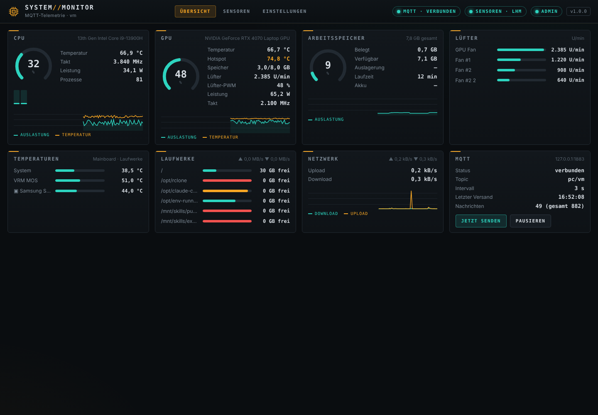

# System-Monitor-MQTT-MK1

**Version 1.0.0**

Kleines Windows-Programm, das unsichtbar im Hintergrund (Infobereich/Tray) läuft und die
Systemauslastung regelmäßig an einen MQTT-Broker sendet. Eingestellt wird alles über eine
lokale Webseite im Dashboard-Design (dunkel, Amber/Teal).



## Gesendete Werte

| Bereich | Werte |
|---|---|
| CPU | Auslastung, Temperatur, Takt, Leistung, optional jeder Kern einzeln |
| GPU | Auslastung, Temperatur, Hotspot, Speicher belegt/gesamt/%, Lüfter U/min und %, Leistung, Takt |
| Arbeitsspeicher | Auslastung, belegt, gesamt, verfügbar, Auslagerung |
| Lüfter | alle Lüfter (Mainboard, Gehäuse, GPU) in U/min |
| Temperaturen | Mainboard-Sensoren, Laufwerkstemperaturen |
| Laufwerke | Belegung und freier Platz je Laufwerk, Lese-/Schreibrate |
| Netzwerk | Upload / Download |
| System | Laufzeit, Prozesse, Akku |
| Rohsensoren | optional **jeder** Sensor von LibreHardwareMonitor (Spannungen, Ströme, Takte …) |

Jeder Wert lässt sich auf der Webseite einzeln an- und abschalten.

## Topics

Basis-Topic (einstellbar, Platzhalter `{hostname}`): Standard `pc/{hostname}`

| Topic | Inhalt |
|---|---|
| `pc/MEINPC/state` | alle Werte als JSON |
| `pc/MEINPC/cpu/usage` | `23.4` |
| `pc/MEINPC/cpu/temperature` | `61.0` |
| `pc/MEINPC/gpu/temperature` | `58.0` |
| `pc/MEINPC/ram/usage` | `41.7` |
| `pc/MEINPC/fans/fan_1` | `1180` |
| `pc/MEINPC/disks/c/usage` | `63.2` |
| `pc/MEINPC/status` | `online` / `offline` (retained, Last Will) |

JSON und Einzel-Topics sind getrennt schaltbar. Die Seite **Einstellungen → Topic & Versand**
zeigt eine Live-Vorschau aller Nachrichten.

## Bedienung

1. `System-Monitor-MQTT-MK1.exe` starten – beim ersten Start öffnet sich die Webseite
   `http://127.0.0.1:8095/`.
2. Unter **Einstellungen** Broker eintragen, *Verbindung testen*, *Speichern*.
3. Topic, Intervall und Messwerte wählen.
4. Optional **Autostart** einschalten.

Das Programm sitzt danach als Symbol im Infobereich (Doppelklick = Dashboard; Rechtsklick =
Pausieren, Jetzt senden, Als Administrator neu starten, Beenden). Ein zweiter Start der exe
öffnet nur das Dashboard der laufenden Instanz.

### Temperaturen und Lüfter (wichtig)

CPU-Temperatur, Mainboard-Temperaturen und Lüfter-Drehzahlen liest das Programm über
**LibreHardwareMonitorLib** (in der exe enthalten). Dafür braucht es:

- **Adminrechte** – Button *Als Administrator neu starten* bzw. Autostart-Modus
  *„Mit Windows starten (Adminrechte)“* (legt eine Aufgabe in der Aufgabenplanung an, startet
  ohne UAC-Abfrage bei der Anmeldung).
- den Treiber **PawnIO** – einmalig installieren:
  <https://github.com/namazso/PawnIO.Setup/releases>

GPU-Werte (NVIDIA, AMD, Intel) funktionieren auch ohne Adminrechte. Die Seite zeigt oben einen
Hinweis, falls etwas fehlt. Unter **Sensoren** sind alle erkannten Rohsensoren mit Wert und
Topic aufgelistet. Bei Notebooks liefert nicht jeder Hersteller Lüfterdrehzahlen an Windows.

### Autostart-Modi

| Modus | Umsetzung | Sensoren |
|---|---|---|
| Aus | – | – |
| Normal | `HKCU\Software\Microsoft\Windows\CurrentVersion\Run` | ohne CPU-Temperatur/Lüfter |
| Adminrechte | Aufgabenplanung „System-Monitor-MQTT-MK1“, höchste Rechte, läuft auch im Akkubetrieb | alle |

## Dateien neben der exe

| Datei | Zweck |
|---|---|
| `System-Monitor-MQTT-MK1.json` | Einstellungen (menschenlesbar, auch von Hand änderbar) |
| `System-Monitor-MQTT-MK1.log` | Protokoll |

Ist der Ordner nicht beschreibbar, landen beide unter `%APPDATA%\System-Monitor-MQTT-MK1`.
Das MQTT-Passwort steht im Klartext in der JSON-Datei.

Der Webseiten-Port (Standard **8095**) ist auf der Webseite änderbar; optional ist die Seite
im LAN erreichbar (dann kann jeder im Netz die Einstellungen ändern).

## Build per GitHub Actions

Inhalt dieses Ordners in ein GitHub-Repository schieben. Der Workflow
`.github/workflows/build-exe.yml` läuft bei jedem Push auf `main`/`master`:

1. lädt `LibreHardwareMonitorLib` (NuGet, .NET Framework 4.7.2) über `lhm/LhmDeps.csproj`
2. installiert die Python-Pakete und baut mit PyInstaller eine einzelne exe ohne Konsole
3. lädt die exe als Artefakt hoch
4. erstellt ein **Release** `vX.Y.Z` mit Zip, sobald `VERSION` in `app/version.py` erhöht wurde

Lokal bauen: `build_local.bat` (Python 3.12 + .NET SDK 8).

## Projektaufbau

```
main.py                  Start, Tray, Einzelinstanz, Neustart als Admin
app/config.py            Einstellungen, Messwert-Liste
app/sensors.py           Erfassung (LibreHardwareMonitor, NVML, psutil)
app/mqtt_pub.py          MQTT-Versand, Nachrichtenaufbau
app/webserver.py         Flask-API
app/autostart.py         Registry / Aufgabenplanung
web/                     Oberfläche (HTML/CSS/JS)
lhm/LhmDeps.csproj       holt LibreHardwareMonitorLib + Abhängigkeiten
System-Monitor-MQTT-MK1.spec   PyInstaller-Spezifikation
```

## Änderungen

### 1.0.0
- Erste Version
