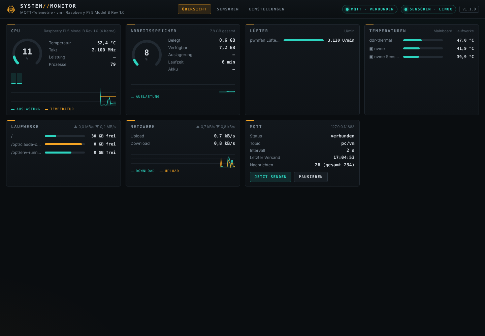

# System-Monitor-MQTT-MK1

**Version 1.1.0**

Kleines Programm, das im Hintergrund läuft und die Systemauslastung regelmäßig an einen
MQTT-Broker sendet. Eingestellt wird alles über eine Webseite im Dashboard-Design
(dunkel, Amber/Teal).

| Plattform | Form | Zusatzinstallation |
|---|---|---|
| Windows 10/11 | eine exe, läuft im Infobereich (Tray) | keine – Sensortreiber wird automatisch mitinstalliert |
| GL.iNet Brume 2 (OpenWrt) | Dienst (procd), Ordner `/root/System-Monitor-MQTT-MK1` | nur `python3` (installiert `install.sh` bei Bedarf selbst) |
| Raspberry Pi / Debian / Ubuntu | Dienst (systemd), Ordner `/opt/System-Monitor-MQTT-MK1` | keine (`python3` ist vorhanden) |

Unter Linux kommt das Programm ohne Zusatzpakete aus (nur Python-Standardbibliothek: eigener
MQTT-Client, eingebauter Webserver, Werte direkt aus `/proc` und `/sys`).




## Gesendete Werte

| Bereich | Werte |
|---|---|
| CPU | Auslastung, Temperatur, Takt, Leistung, optional jeder Kern einzeln |
| GPU | Auslastung, Temperatur, Hotspot, Speicher belegt/gesamt/%, Lüfter U/min und %, Leistung, Takt |
| Arbeitsspeicher | Auslastung, belegt, gesamt, verfügbar, Auslagerung |
| Lüfter | alle Lüfter (Mainboard, Gehäuse, GPU) in U/min |
| Temperaturen | Mainboard-Sensoren, Laufwerkstemperaturen |
| Laufwerke | Belegung und freier Platz je Laufwerk, Lese-/Schreibrate |
| Netzwerk | Upload / Download |
| System | Laufzeit, Prozesse, Akku |
| Rohsensoren | optional **jeder** Sensor von LibreHardwareMonitor (Spannungen, Ströme, Takte …) |

Jeder Wert lässt sich auf der Webseite einzeln an- und abschalten.

## Topics

Basis-Topic (einstellbar, Platzhalter `{hostname}`): Standard `pc/{hostname}`

| Topic | Inhalt |
|---|---|
| `pc/MEINPC/state` | alle Werte als JSON |
| `pc/MEINPC/cpu/usage` | `23.4` |
| `pc/MEINPC/cpu/temperature` | `61.0` |
| `pc/MEINPC/gpu/temperature` | `58.0` |
| `pc/MEINPC/ram/usage` | `41.7` |
| `pc/MEINPC/fans/fan_1` | `1180` |
| `pc/MEINPC/disks/c/usage` | `63.2` |
| `pc/MEINPC/status` | `online` / `offline` (retained, Last Will) |

JSON und Einzel-Topics sind getrennt schaltbar. Die Seite **Einstellungen → Topic & Versand**
zeigt eine Live-Vorschau aller Nachrichten.

## Installation unter Linux (Brume 2 / Raspberry Pi)

Zip `System-Monitor-MQTT-MK1-vX.Y.Z-linux.zip` (aus dem Release oder diesem Repo) auf das Gerät kopieren
und dort entpacken; `install.sh` erledigt den Rest (Python prüfen, Dienst mit Autostart einrichten,
auf OpenWrt zusätzlich eine Firewall-Regel für den Webport).

**GL.iNet Brume 2** (scp funktioniert dort nur mit `-O`):

```
scp -O System-Monitor-MQTT-MK1-v1.1.0-linux.zip root@192.168.8.1:/root/
ssh root@192.168.8.1
cd /root && unzip -o System-Monitor-MQTT-MK1-v1.1.0-linux.zip
sh System-Monitor-MQTT-MK1/install.sh
```

**Raspberry Pi:**

```
scp System-Monitor-MQTT-MK1-v1.1.0-linux.zip pi@raspberrypi:~
ssh pi@raspberrypi
unzip -o System-Monitor-MQTT-MK1-v1.1.0-linux.zip
sudo sh System-Monitor-MQTT-MK1/install.sh
```

Danach ist die Webseite unter `http://<IP-des-Geräts>:8095/` erreichbar (unter Linux standardmäßig
im ganzen LAN). Update: neue Zip genauso entpacken und `install.sh` erneut ausführen – die
Einstellungen bleiben erhalten. Entfernen: `sh uninstall.sh` im Programmordner.

Unter Linux werden gesendet: CPU-Last (gesamt/je Kern), CPU-Temperatur (z. B. `cpu_thermal` beim
Raspberry), Takt, RAM, Auslagerung, Laufwerke, Lese-/Schreibrate, Netzwerk, Laufzeit, Prozesse,
alle `hwmon`-/`thermal`-Sensoren (z. B. Raspberry-Pi-5-Lüfter `pwmfan`, NVMe-Temperatur) und –
falls eine NVIDIA-Karte mit `nvidia-ml-py` vorhanden ist – GPU-Werte. Der Dienst schreibt sein
Protokoll auf OpenWrt nach `/tmp` (schont den Flash).

## Bedienung unter Windows

1. `System-Monitor-MQTT-MK1.exe` starten – beim ersten Start öffnet sich die Webseite
   `http://127.0.0.1:8095/`.
2. Unter **Einstellungen** Broker eintragen, *Verbindung testen*, *Speichern*.
3. Topic, Intervall und Messwerte wählen.
4. Optional **Autostart** einschalten.

Das Programm sitzt danach als Symbol im Infobereich (Doppelklick = Dashboard; Rechtsklick =
Pausieren, Jetzt senden, Als Administrator neu starten, Beenden). Ein zweiter Start der exe
öffnet nur das Dashboard der laufenden Instanz.

### Temperaturen und Lüfter unter Windows

CPU-Temperatur, Mainboard-Temperaturen und Lüfter-Drehzahlen liest das Programm über
**LibreHardwareMonitorLib** (in der exe enthalten). Diese braucht Adminrechte und den Treiber
**PawnIO** – beides ohne Handarbeit:

- Beim ersten Start oben auf **„Alle Sensoren aktivieren“** klicken (einmal UAC bestätigen).
- Das Programm startet mit Adminrechten neu und installiert dabei das in der exe enthaltene,
  signierte PawnIO-Setup still im Hintergrund (`PawnIO_setup.exe -install -silent`).
- Danach schlägt die Seite vor, den **Autostart mit Adminrechten** einzurichten – dann läuft
  bei jedem Windows-Start alles ohne Nachfrage.

Abschaltbar unter *Einstellungen → Programm → Sensortreiber*. GPU-Werte (NVIDIA, AMD, Intel)
funktionieren auch ohne Adminrechte. .NET Framework 4.7.2+ ist in Windows 10/11 bereits enthalten.
Bei Notebooks liefert nicht jeder Hersteller Lüfterdrehzahlen an Windows.

### Autostart-Modi

| Modus | Umsetzung | Sensoren |
|---|---|---|
| Aus | – | – |
| Normal | `HKCU\Software\Microsoft\Windows\CurrentVersion\Run` | ohne CPU-Temperatur/Lüfter |
| Adminrechte | Aufgabenplanung „System-Monitor-MQTT-MK1“, höchste Rechte, läuft auch im Akkubetrieb | alle |

## Dateien neben der exe

| Datei | Zweck |
|---|---|
| `System-Monitor-MQTT-MK1.json` | Einstellungen (menschenlesbar, auch von Hand änderbar) |
| `System-Monitor-MQTT-MK1.log` | Protokoll |

Ist der Ordner nicht beschreibbar, landen beide unter `%APPDATA%\System-Monitor-MQTT-MK1`.
Das MQTT-Passwort steht im Klartext in der JSON-Datei.

Der Webseiten-Port (Standard **8095**) ist auf der Webseite änderbar; optional ist die Seite
im LAN erreichbar (dann kann jeder im Netz die Einstellungen ändern).

## Build per GitHub Actions

Inhalt dieses Ordners in ein GitHub-Repository schieben. Der Workflow
`.github/workflows/build-exe.yml` läuft bei jedem Push auf `main`/`master`:

1. lädt `LibreHardwareMonitorLib` (NuGet, .NET Framework 4.7.2) über `lhm/LhmDeps.csproj`
2. lädt das aktuelle PawnIO-Setup aus `namazso/PawnIO.Setup` (wird in die exe gepackt)
3. installiert die Python-Pakete und baut mit PyInstaller eine einzelne exe ohne Konsole
4. lädt die exe als Artefakt hoch
5. erstellt ein **Release** `vX.Y.Z` mit Windows-Zip **und Linux-Zip**, sobald `VERSION` in
   `app/version.py` erhöht wurde

Für Linux ist kein Build nötig – der Quellcode läuft direkt.

Lokal bauen: `build_local.bat` (Python 3.12 + .NET SDK 8).

## Projektaufbau

```
main.py                  Start, Tray, Einzelinstanz, Neustart als Admin, Dienstbetrieb
app/config.py            Einstellungen, Messwert-Liste
app/sensors.py           Erfassung (Windows: LibreHardwareMonitor, NVML, psutil)
app/linux_sys.py         Erfassung Linux (/proc, /sys, hwmon, thermal)
app/driver.py            PawnIO automatisch installieren (Windows)
app/mqtt_client.py       eigener MQTT-3.1.1-Client (Standardbibliothek)
app/mqtt_pub.py          MQTT-Versand, Nachrichtenaufbau, Wiederverbinden
app/webserver.py         Webserver + API (http.server)
app/autostart.py         Registry / Aufgabenplanung / Linux-Dienststatus
install.sh, uninstall.sh Linux-Installation (procd bzw. systemd)
web/                     Oberfläche (HTML/CSS/JS)
lhm/LhmDeps.csproj       holt LibreHardwareMonitorLib + Abhängigkeiten
System-Monitor-MQTT-MK1.spec   PyInstaller-Spezifikation
```

## Änderungen

### 1.1.0
- Linux-Unterstützung: GL.iNet Brume 2 (OpenWrt/procd) und Raspberry Pi (systemd) mit `install.sh`
- Linux-Sensoren direkt aus `/proc` und `/sys` (CPU, RAM, Laufwerke, Netz, hwmon, thermal, Akku)
- Keine Zusatzpakete mehr nötig: eigener MQTT-Client und Standard-Webserver statt paho-mqtt/Flask
- Windows: PawnIO-Treiber steckt in der exe und wird bei Adminrechten automatisch installiert
- „Alle Sensoren aktivieren“ und Vorschlag „Autostart mit Adminrechten“ direkt auf der Übersicht
- GPU-Kachel wird ausgeblendet, wenn keine GPU-Daten vorhanden sind
- Release enthält zusätzlich ein Linux-Zip

### 1.0.0
- Erste Version
